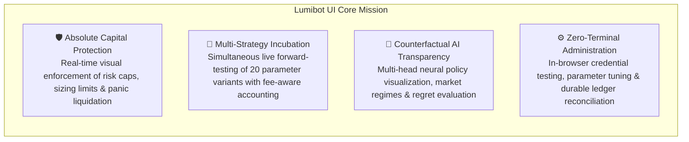
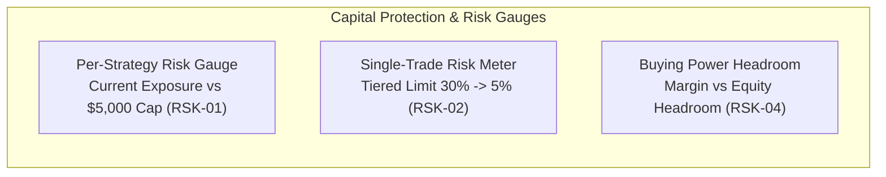

# Lumibot Trading Dashboard — Mission, Architecture & User Features Guide

The **Lumibot Trading Dashboard** is the real-time graphical mission control center for the Lumibot automated options trading engine. Revamped with **Reflex for Python** (`reflex_dashboard/`), it runs as an interactive, reactive full-stack web application (serving on [http://localhost:3000](http://localhost:3000) and mapped to [http://localhost:8501](http://localhost:8501)) packaged inside a lightweight Docker container.

Following the **Claude Code Frontend Design Toolkit** guidelines, the interface adopts a **Dark OLED Quantitative Trading Terminal** aesthetic (Obsidian `#080A10`, surface `#10141E`, crisp borders `#1F273D`, and cyber teal/cyan `#00D4B2`), pairing high-density Radix UI primitives with tabular monospace figures (`JetBrains Mono`) for strikes, Greeks, deltas, fees, and currency alignment. Real-time updates occur over WebSockets (`rx.State`), eliminating full-page rerun flickering.

The legacy Streamlit implementation remains preserved at `dashboard/app.py` for backward compatibility.

---

## 1. Executive Summary & UI Mission

The dashboard is designed around four core architectural pillars:



1. **Absolute Capital Safety Oversight**: Provide immediate, visual awareness of portfolio risk boundaries ($5,000 global open position cap, single-trade sizing limits, buying power headroom) and offer guarded, one-click panic liquidation without opening a terminal.
2. **Transparent Multi-Strategy Incubation**: Forward-test 20 concurrent Iron Condor variants (`IC_V01`–`IC_V20`) on live broker feeds, tracking gross midpoint returns, exchange fees ($0.40/contract leg), net realized P&L, and net ROI%.
3. **Counterfactual AI & Neural Policy Demystification**: Make deep reinforcement learning and machine learning decisions interpretable by exposing latent market regime states, live action probability distributions (`HOLD`, `ADD`, `TRIM`, `FLATTEN`), dynamic profit targets, and counterfactual regret against the hindsight-best strategy.
4. **Zero-Terminal Administration**: Allow traders to configure, test, and save broker credentials (Tradier Sandbox/Live, Alpaca Paper/Live), adjust strategy parameters, and reconcile broker cash flows directly through the web browser.

---

## 2. Global Header & Telemetry Bar (`GUI-01`, `GUI-02`)

The top of the dashboard displays persistent, real-time account telemetry and engine state across all views:

| Telemetry Component | Source / Engine Mapping | User Benefit |
| :--- | :--- | :--- |
| **Market Session Clock** | Eastern Time (`America/New_York`) | Displays current session state: `Pre-Market`, `Regular Trading Hours`, or `Post-Market`. |
| **Engine Heartbeat Status** | `logs/trading.log` parser | Shows whether the trading bot is actively monitoring, trading, sleeping until market open, or offline. |
| **Account Equity & Cash** | Broker API (`/v1/accounts/{id}/balances`) | Live broker-reported total equity, settled cash, and option buying power. |
| **Option Margin Requirement** | Broker API margin payload | Current dollar margin held by broker against open option positions. |
| **Unrealized Account P&L** | Live broker quote marks | Immediate aggregate unrealized dollar gain/loss across all open positions. |
| **Active Incubator Grid Pill** | Trade logs & SQLite Position Ledger | Displays variant utilization count (e.g., `11/20 Active`). |

---

## 3. Capital Protection & Risk Gauges (`RSK-01` – `RSK-04`, `GUI-02`)

Prominently positioned beneath the header, these gauges provide at-a-glance safety verification:



- **`RSK-01`: $5,000 Per-Strategy Open Position Cap**:
  - Radial progress dial tracking defined risk per individual strategy variant against the hard $5,000.00 single-strategy ceiling:
    $$\text{Strategy Open Risk} = \sum_{\text{strategy}} (\text{Wing Width} \times 100 \times \text{Contracts}) \le \$5,000.00$$
  - *Note*: This cap is enforced **per individual strategy**, allowing concurrent forward-testing across the 20-strategy incubator grid without cross-strategy risk starvation.
- **`RSK-02`: Tiered Single-Trade Sizing**:
  - Visualizes maximum allowable risk for any single trade based on portfolio capital (30% at $5k cap = $1,500 max loss per trade, scaling down to 5% for accounts > $50k).
- **`RSK-03`: Intelligent Contract Auto-Scaling Alert**:
  - Displays dynamic notifications when a strategy's requested quantity was scaled down to prevent exceeding single-trade limits (e.g., `Scaled from 10 to 7 contracts`).
- **`RSK-04`: Option Buying Power Headroom**:
  - Compares broker-reported option requirement against total account equity.

---

## 4. In-Depth Dashboard Tabs Breakdown

The dashboard is structured into 9 dedicated tabs:

```
[🧬 20-Strategy Incubator Grid]  [🧠 Neural Policy & Evaluation]  [📈 S&P 500 Benchmark]
[⚖️ A/B Strategy Lab]           [📊 Active Positions & Greeks]  [📋 Orders & Activity]
[⚙️ Broker & Strategy Config]   [📜 Real-Time Log Console]       [📘 User Features Matrix]
```

---

### Tab 1: 🧬 20-Variant Strategy Incubator Grid (`EXP-05`)
The primary operational view for forward-testing 20 distinct Iron Condor variations concurrently on Mini-SPX (`XSP`) or `SPY`.

* **Top Metric Scorecards**:
  - **Active Incubator Grid**: Active variants vs total configured (20).
  - **Total Completed Trades & Win Rate**: Completed round-trips and win percentage calculated strictly on **net positive dollar return**.
  - **Gross Realized P&L**: Theoretical gain based on option midpoint prices.
  - **Contract Fees Paid**: Accurate accounting of exchange and regulatory fees ($0.40 per contract leg = $3.20 roundtrip per 4-leg condor).
  - **Net Realized P&L**: Bottom-line cash return after fees:
    $$\text{Net P&L} = \text{Gross Realized P&L} - \text{Roundtrip Fees}$$
* **🏛️ Broker Account Cash Flow & Equity Reconciliation**:
  - Dedicated callout panel reconciling trade journal records against actual broker cash transactions:
    - Starting Capital: `$100,000.00`
    - Gross Option Buys (Debits) vs Gross Option Sells (Credits)
    - Net Broker Closing Realized Fills (`close_pl`)
    - Regulatory & Contract Fees ($0.40 × total executed contracts)
    - Ending Tradier Account Equity
* **Performance Leaderboard Table**:
  - Interactive table sortable by **Net Realized P&L** or **Numeric Order (`IC_V01`–`IC_V20`)**.
  - Displays: `Variant`, `Delta (Δ 0.08–0.25)`, `Wing ($2–$15)`, `DTE (0DTE/1DTE)`, `Profit Target (25%–65%)`, `Stop Loss (1.5x–3.0x)`, `Entry Window (09:45–13:00 ET)`, `Closed Trades`, `Open Trades`, `Win Rate %`, `Gross P&L`, `Fees`, `Net Realized P&L`, `Net ROI%`, `Credit Collected`, and `Status`.
* **Cumulative Net Equity Curves**:
  - Interactive multi-curve Plotly chart tracking individual variant equity trajectories over time.
* **Single-Variant Inspector**:
  - Dropdown selector to inspect any variant's exact parameters, closed trade logs, and recent broker executions.

---

### Tab 2: 🧠 Neural Policy & Evaluation (`ML-01` – `ML-07`)
Exposes the multi-head deep reinforcement learning model and counterfactual evaluation pipeline.

* **KPI Summary Cards**:
  - **Policy Model Status**: Model artifact validation (`logs/models/policy.json`).
  - **Latent Market Regime**: Active regime classification (`Low-Vol Pin`, `Mean-Reverting Chop`, `Directional Trend`, `High-Vol Expansion`).
  - **Dynamic Profit Target**: Real-time predicted expected exit value (e.g. `35.0%`) overriding static thresholds.
  - **Contextual Selector**: Optimal grid variant chosen for prevailing market volatility.
* **🎯 Neural Policy Recommendation Panel**:
  - Live horizontal bar chart showing output probability distributions across:
    - `HOLD`: Maintain open contracts.
    - `ADD_POSITION`: Scale into favorable mean-reverting conditions (within risk caps).
    - `TRIM_POSITION`: Cut position size by 50% when wing stress accelerates.
    - `TAKE_PROFIT / FLATTEN`: Dynamically bank gains ahead of adverse reversals.
* **Counterfactual Regret Scorecard (`ML-07`)**:
  - Compares the model's actual actions against the hindsight-optimal action across all 20 variants:
    $$\text{Regret}_t = \max_{i \in \{1..20\}} R_t(A_i) - R_t(A_{\text{bot}})$$
* **Capture Efficiency Gauge (MFE / MAE)**:
  - Ratio of realized profits to Maximum Favorable Excursion and drawdown avoided via early trims.

---

### Tab 3: 📈 S&P 500 Benchmark Lab
Compares bot performance against buy-and-hold benchmarks (`SPY` / `SPX`).

* **Comparative Metrics**:
  - Annualized Return, Sharpe Ratio, Sortino Ratio, Maximum Drawdown, Beta ($\beta$), Jensen's Alpha ($\alpha$), and Excess Return.
* **Interactive Return Overlay Chart**:
  - Cumulative strategy return curve plotted against S&P 500 index total return.

---

### Tab 4: ⚖️ A/B Strategy Multi-Execution Lab (`EXP-01` – `EXP-04`)
Facilitates direct head-to-head testing between two distinct parameter configurations.

* **Dual Strategy Cards**:
  - Strategy A (Conservative Baseline: e.g. 15-delta, 30% PT) vs Strategy B (Aggressive Challenger: e.g. 20-delta, 50% PT).
* **Isolated Order Tagging (`EXP-03`)**:
  - Color-coded strategy identification tags (`[Strategy A: Blue]`, `[Strategy B: Orange]`) preventing cross-ledger confusion.
* **Comparative Scorecard**:
  - Side-by-side win rate, total P&L, average trade duration, and profit factor.

---

### Tab 5: 📊 Active Positions & Greeks (`GUI-03`, `GUI-04`)
Provides live inspection of all open contracts.

* **Interactive Leg Matrix**:
  - Displays Strategy Tag, Leg Symbol, Put/Call Right, Strike Price, Expiration, Quantity, Cost Basis, Market Mid-Price, Delta ($\Delta$), Theta ($\Theta$), IV, and Unrealized P&L.
* **Interactive Payoff Explorer (`GUI-04`)**:
  - Plotly expiration payoff diagram charting net P&L across underlying prices.
  - Highlights upper and lower breakeven boundaries, max-profit zone, and max-loss wings.

---

### Tab 6: 📋 Orders & Activity
Real-time audit log of all broker transactions.

* **Live Order Book**:
  - Filterable table displaying Order ID, Strategy Tag, Symbol, Leg Action (`buy_to_open`, `sell_to_open`, `buy_to_close`, `sell_to_close`), Quantity, Limit Price, Fill Price, Submission Time, and Status (`filled`, `canceled`, `rejected`, `open`).

---

### Tab 7: ⚙️ Broker & Strategy Configuration (`CFG-01`, `BRK-01`, `BRK-02`)
Interactive configuration suite with atomic persistence to `.env`.

* **Broker Selection & Credentials**:
  - Radio toggle: **Tradier (Sandbox / Live)** vs **Alpaca (Paper / Live)**.
  - Secure inputs for API tokens, account numbers, and paper/live flags.
  - **🔌 Test Connection Buttons**: Validates credentials via live authenticated ping and displays equity and buying power instantly.
* **Iron Condor Strategy Parameters**:
  - Underlying Symbol (`XSP`, `SPX`, `SPY`).
  - Target DTE (`0` for 0DTE intraday, `1` for 1DTE swing).
  - Short Strike Delta slider ($\Delta 0.05–0.35$).
  - Wing Width numerical input ($0.5–50.0\text{ pt}$).
  - Quantity input (contracts per trade).
  - Entry Window start time (`HH:MM` ET).
  - Profit Target % ($10\%–80\%$) & Stop Loss Multiplier ($1.0x–4.0x$).
* **Capital Protection & Fee Boundaries**:
  - Global Max Open Risk ($500–$100,000).
  - Max Single-Trade Risk % ($5\%–50\%$).
  - Option Fee per Contract Leg ($0.00–$5.00, default: `$0.40`).
* **Atomic Save**:
  - "💾 Save All Configuration to .env" button validates inputs, saves changes, and prompts container restart.

---

### Tab 8: 📜 Real-Time Log Console (`GUI-05`)
Embedded system monitoring eliminating the need for terminal access.

* **Live Log Stream**:
  - Reads from `logs/trading.log`.
  - Filter by log severity (`INFO`, `WARNING`, `ERROR`) or keyword search.
  - Configurable line limit (last 50 to 1,000 lines) with auto-refresh capability.

---

### Tab 9: 📘 User Features Matrix
Interactive reference catalog rendering the entire [USER_FEATURES.md](file:///Users/yevgeniysaykin/Documents/Projects/lumibot/USER_FEATURES.md) specification directly inside the dashboard for operator cross-referencing.

---

## 5. One-Click Emergency Control Center (`GUI-06`)

Located in the dashboard sidebar, guarded panic controls allow operators to intervene instantly during unforeseen market events:

| Emergency Action | Scope | Mechanism |
| :--- | :--- | :--- |
| **Flatten Strategy A** | Single Variant | Immediately submits market closing orders for Strategy A's open legs only. |
| **Flatten Strategy B** | Single Variant | Immediately submits market closing orders for Strategy B's open legs only. |
| **🚨 Emergency Flatten All** | Global Portfolio | Submits closing orders across **all 20 strategy variants**, liquidating the entire options portfolio. |
| **Cancel All Orders** | Open Orders | Cancels all working or pending limit orders across all symbols. |
| **Trading Pause / Resume** | New Entries | Locks the engine against opening new trades while continuing active management and stop-loss monitoring of open positions. |

---

## 6. Architecture & Deployment

The dashboard is decoupled from the trading engine to prevent GUI crashes or browser reloads from impacting strategy execution:

```
┌────────────────────────────────┐         ┌────────────────────────────────┐
│   lumibot-bot (Container)      │         │   lumibot-dashboard (Container)│
│  - main.py                     │         │  - dashboard/app.py            │
│  - 20 Incubator Strategies     │         │  - Streamlit UI (Port 8501)    │
│  - MarketDataHub               │         │  - Plotly Charts               │
│  - PositionLedger (SQLite)     │         │  - Real-Time Broker Telemetry  │
└───────────────┬────────────────┘         └───────────────┬────────────────┘
                │                                          │
                ▼                                          ▼
     ┌──────────────────────────────────────────────────────────┐
     │ Shared Host Volumes:                                     │
     │  - logs/trajectories.jsonl (5-min state & actions)       │
     │  - logs/position_ledger.sqlite3 (Transactional fills)    │
     │  - logs/trading.log (Execution telemetry)                │
     │  - .env (Shared credentials & risk parameters)           │
     └──────────────────────────────────────────────────────────┘
```

- **Container Name**: `lumibot-dashboard`
- **Port Mapping**: `8501:8501`
- **Start / Restart Commands**:
  ```bash
  # Start or update dashboard container
  docker compose up -d --build lumibot-dashboard

  # Check logs
  docker logs -f lumibot-dashboard
  ```
- **Browser Access**: Open `http://localhost:8501`.
